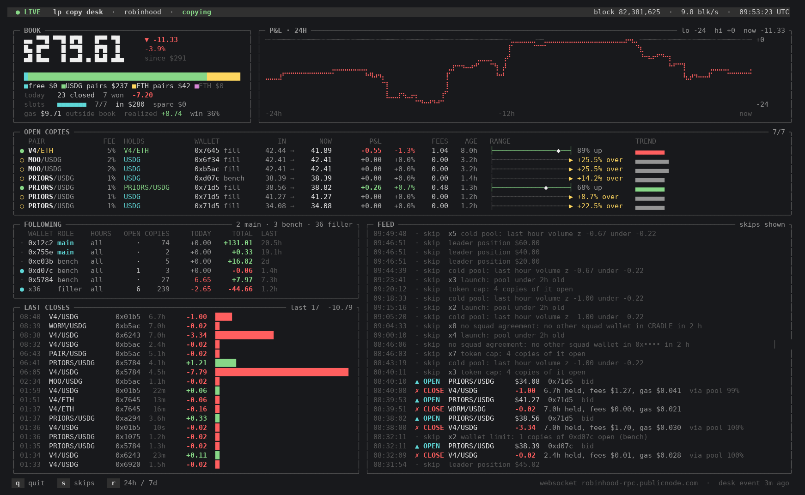

# lp-copy-desk

A copy-trading desk for Uniswap v4 liquidity on Robinhood Chain. It finds wallets whose LP positions make money,
replays what copying them would have earned at your size and your delay, picks a squad from those replays, and then
copies the squad's new positions live: same pool, same range, your size. It exits when the leader exits.

Everything is driven from one command line, `./lpdesk`, and every command also speaks `--json`.



<sub>`./lpdesk watch` on the live desk (2026-10-07). It's realtime off the chain's websocket: a swap in one of our pools re-values that copy at once, and a followed wallet's mint is in the feed before the desk has copied it. Wallets always show as `0x` plus 4 hex.</sub>

This code ran live with real money from 2026-09-28 to 2026-10-07 as part of a larger private bot. It is extracted here
whole, with its tests and the backtests behind every setting.

## How it did (honestly)

The live desk's own record, 09-28 to 10-07: **1,180 copies closed, net -$11.96** on a book of roughly $200-600.

| | |
|---|---|
| 09-29 to 10-01 | +$296 |
| 10-02 to 10-04 | -$345 (launch-pool dumps, before the launch rules below existed) |
| 10-05 to 10-07 | +$37 |

Copying works when the leaders are good and the pools are not launches. It loses when a pool is minutes old, when its
creator still holds the liquidity, or when the desk is the last buyer in a thin pool. Most of the rules in
`chains/robinhood/chain.example.toml` exist because one of those happened. Each rule carries the backtest that set it.
Treat the numbers in those comments as the desk's history, not as a promise.

## How it works

```
history store (copydesk/lphist)    every v4 swap, position and LP NFT on the chain, kept locally (~100 MB a day, 14 days)
        |
discovery (copydesk/lpfind)        every wallet that minted >= 7 positions over 7 days on >= 2 days
        |
replay (copydesk/lpcopy, lplive)   each wallet's positions copied at OUR size and OUR measured delay, with our gas and the
        |                          desk's live rules (the same code path the desk uses to decide)
score (copydesk/lpdb)              (mean - one standard error) x copies a day x trust (how well the replay reproduces the
        |                          wallet's own P&L); validated blind: its top 20 earned +1.16 %/copy the next day vs +0.08 %
pick (copydesk/lpopt)              mains (2), bench, filler, written into chain.toml [lp.follow]; repicked hourly
        |
the desk (copydesk/lpfollow)       a websocket on the PositionManager: a squad mint -> checks -> our mint in the same range
                                   -> exit when the leader's liquidity falls under half its peak
treasury (copydesk/treasury)       the only place USDG <-> ETH converts; keeps the gas band; sells dust
exit routing (core/exec/lp)        sells the token side wherever pays most: every hookless USDG / ETH pool of the token,
                                   quoted exactly, and Relay's quote beside them
```

The desk's checks before a copy include:
- pool age (no pools under 2 h)
- the launch creator still in
- a cold pool (last hour's volume z-score) and a price-flat pool
- a thin pool (our share of active liquidity)
- the entry swap's cost
- squad agreement for filler copies
- a token cool-off after losses
- per-token and per-wallet caps
- slot and capital room by tier (main > bench > filler; a main copy closes lower tiers' copies to make room)

## Install

```sh
git clone https://github.com/p2pa/lp-copy-desk && cd lp-copy-desk
./setup.sh            # venv + packages, then `./lpdesk setup`: config, a new desk wallet, Telegram (optional), doctor
```

`./setup.sh --yes --cron` asks nothing (a new wallet if there is none, no Telegram) and installs the schedule into your
crontab. Installing the schedule never starts trading: the live desk runs only once `ops/LIVE` exists (below).

Python 3.11+ is needed. Everything private lives outside the repo in `~/.config/lp-copy-desk/`, mode 600, and is never committed:
- `wallets.json`: `./lpdesk wallet new` makes it. Use a wallet that holds only what the desk may lose.
- `telegram.json` (optional): `{"token": ..., "chat_id": ...}`.
- `hypersync.token` (optional): an envio.dev token, for wallet forensics.
- `rpc.url` (optional): a keyed endpoint, read before the public ones.

## First run

```sh
./lpdesk hist backfill 10        # build the history store (hours on public endpoints)
./lpdesk nightly --dry           # discover, replay, score: who would it pick?
./lpdesk pick --apply            # write the squad into chain.toml
./lpdesk run                     # the desk WITHOUT --go: it hears, decides and logs, signs nothing
./lpdesk wallet                  # fund the address it shows: USDG for the book, ~$5 of ETH for gas
touch ops/LIVE                   # live: the supervisor (cron, every minute) starts `run --go` with LIVE_OK=yes
```

## Run it on a server (AWS or anywhere with ssh)

Latency matters for a copy desk: the sooner your mint lands after the leader's, the closer your fill is to theirs.
Robinhood Chain's sequencer sits in AWS us-east-2. From a box there, the sequencer was 2.1 ms away, against 113 ms from
Helsinki, and blocks arrived 41-124 ms earlier (measured 2026-09-26). The desk ran on a `t3.small` (2 vCPU, 2 GB, about
$15 a month) beside its own chain node. There, copies landed about 2 blocks after the leader; from Europe it was
about 33 blocks.

```sh
# 1. a box: Ubuntu 24.04 in us-east-2, an encrypted root volume (the wallet key rests on it), ssh only from your IP
aws ec2 run-instances --region us-east-2 --instance-type t3.small --image-id <ubuntu-24.04-ami> --key-name <your-key> \
  --security-group-ids <sg-ssh-from-your-ip> --block-device-mappings '[{"DeviceName":"/dev/sda1","Ebs":{"Encrypted":true,"VolumeSize":30}}]'
ssh ubuntu@<ip> 'sudo apt-get update -q && sudo apt-get install -yq python3-venv rsync'

# 2. the desk on it: code, your chain.toml, setup and the schedule, in one command
ops/deploy.sh ubuntu@<ip>                 # a fresh desk there, with its own new wallet
ops/deploy.sh ubuntu@<ip> --history       # ... and this box's history store, so it does not rebuild it for hours
ops/deploy.sh ubuntu@<ip> --move --live   # MOVE a running desk: wallet, book, open copies and history go there, then live

# 3. from your laptop
ssh -t ubuntu@<ip> 'cd lp-copy-desk && ./lpdesk watch'
ssh ubuntu@<ip> 'cd lp-copy-desk && ./lpdesk status --json'
```

`--move` refuses while the desk still runs here: one wallet has one signer, or two desks race for its nonces. Stop it here
first (`rm ops/LIVE`, then kill its PID; SIGTERM is graceful). Re-running `ops/deploy.sh` updates the code. The box's own
state (`chains/<chain>/var/`) is never overwritten unless you pass `--move`. Code reaches a running desk only when you deploy, never by
itself, so a half-edited file cannot reach a desk that its supervisor would restart.

## Commands

`./lpdesk help` lists them all. The ones you will use:

| | |
|---|---|
| `setup`, `doctor`, `wallet [new]` | install, check, the desk wallet |
| `status` | every open copy checked against its leader and the chain, the record, the exit sales |
| `watch` | full screen and live |
| `log [N\|tokenId\|SYM\|0x..\|skips H\|errors H]` | the desk's own records, one copy at a time |
| `stop` / `resume` | no new copies (open ones still exit with their leaders) / copying again |
| `close <leader tokenId>` | close one copy through the desk's own exit |
| `treasury [resume]` | conversions, gas band, dust |
| `pick [--apply]`, `qc`, `find board` | who to follow |
| `wallet <addr>`, `copy <addr>`, `backtest <addr>` | one wallet: its P&L, and what copying it would have made |
| `tune`, `tune downside`, `tune recency` | the blind fold tests behind the desk's settings |

## Safety

- Nothing signs without `--go` AND `LIVE_OK=yes` in the environment, and the supervisor runs the desk only while `ops/LIVE` exists.
- `./lpdesk stop` writes the desk's STOP file: no new copies. The desk keeps running so open copies still exit with their leaders.
- `stop_drawdown` pauses copying for `stop_pause_h` hours after a drawdown from the realized high-water mark.
- The fork tests run every write path against an anvil fork. The fork has a private chain id (real + 1,000,000), only local URLs, and throwaway keys, so a signature made there can never reach the real chain.

## Tests

```sh
./lpdesk smoke                     # offline
.venv/bin/python -m tests.copyfork # 37 asserts: entry, failed mint undo, ETH pools via the treasury, tiers, exits, the books to a cent
.venv/bin/python -m tests.exitfork # 7 asserts: a token sold through the best route (needs var/lp_heat.json from `hist ingest`)
.venv/bin/python -m tests.ladderfork  # Delta Liquidity ladders as one copy (needs the history store and a recent ladder; see CLAUDE.md)
```

The fork tests need foundry's `anvil` (`ANVIL=/path/to/anvil` if it is not in `~/.foundry/bin`).

## Layout

```
lpdesk, cli.py         the command line
copydesk/              the desk, the replay, the score, the pick, the history store, the treasury, the Telegram card
core/                  the slice of the engine the desk uses: chain config, RPC, v4 tick maths, LP execution
                       (approve, swap, mint, exit on PositionManager / UniversalRouter), signing, Telegram
discovery/, research/  wallet forensics (HyperSync), pool features at entry, and the pool-score studies (below)
chains/robinhood/      chain.example.toml (every desk setting, with why), rpc.toml (public endpoints); var/ is state
docs/                  the research behind it: LPWALLETS (finding wallets), LPAGENT, LPML (a model that did not beat
                       copying), DELTA (managed ladders)
tests/                 the fork tests
ops/                   deploy.sh (a server in one command), supervise.sh (keeps the desk up while ops/LIVE exists), crontab.example
setup.sh               a fresh box in one command
```

## The pool score (research/, as found)

The desk's replayed copies also fed a second idea: score POOLS, not wallets, by what everyone's replayed copies earned there,
and trade the top pools without following anyone. These are the studies behind it, copied as they ran inside the larger bot
(2026-10-02 to 10-07). Some import that bot's robot modules (`research/bidwall`, `research/robot`), which are not in this repo:
read them as the record of the work, not as tools that run here.

| | |
|---|---|
| `poolscore.py` | the score: (mean - SE) x copies a day of a pool's replayed copies, trailing 1 day |
| `scoresvc.py` | the service that published it every 15 min, sealed snapshots (an hourly paper recipe traded on it) |
| `persist.py` | does winning persist? wallets and pools, window A vs B, rank correlation with an interval |
| `decay.py` | how fresh the score has to be (1-24 h refresh) |
| `capacity.py` | per-copy return by the copy's share of in-range liquidity |
| `payscore.py` | the same score from what pools really paid their LPs, no replay |
| `lpfactor.py`, `lpfeat.py` | pool factors (volatility, waking up) and the residual test for new features |
| `squadscore.py`, `launch.py` | the squad's own copies as a score; who is in a young pool |

The outcome, for the record: the hourly pool-score recipe made +40 % on a $1,000 paper account over the same days a
quote-only bid-wall robot (no wallets, no score) made +99 %; it was retired with the desk.

## Scope

- **One chain:** Robinhood Chain (4663), Uniswap v4, USDG and native-ETH pools without hooks. Another chain needs its own `chains/<name>/` config and a look at the token / router assumptions in `core/exec/lp.py`.
- **Licence:** none chosen yet.
